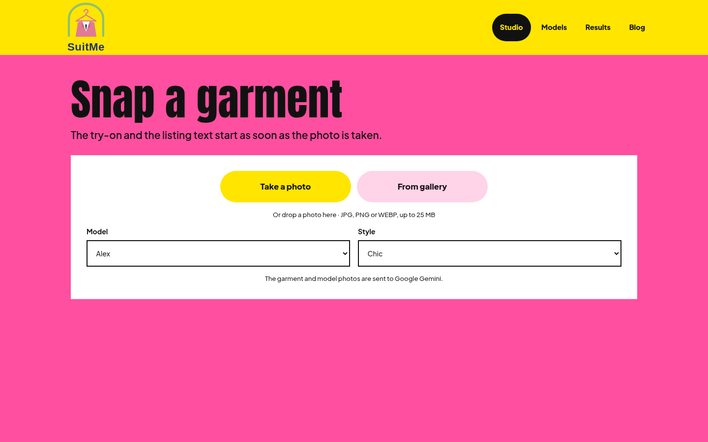

# SuitMe

SuitMe is a personal, mobile-first web workspace for preparing virtual try-on images and listing content for clothing items.



The repository contains an interactive personal-use web app. Model profiles, reference photos, results, and edited listing fields are saved in this browser. Garment uploads remain temporary in memory. Try-on generation uses Google Gemini image generation through a server-side route.

## Product direction

- Optimize for one person's repeated use rather than a multi-user marketplace.
- Keep the main workflow linear: upload a garment, choose a model and style, review results.
- Use as few visible actions as possible on each screen.
- Make the primary action obvious, large, and comfortable to tap.
- Explain every action through its label and visible result.
- Keep all product UI and project documentation in English.
- The selected garment and model reference photos are sent to Google Gemini only when Generate try-on is used.

## Generation modes (`/api/generate`)

- Try-on (default): the model photo is sent first and Gemini is told to edit it, replacing only the clothing. Pose, framing, background and lighting must stay as in the reference.
- Enhance (`mode: "enhance"`, `enhanceStyle`): retouches a reference photo into a fashion shot (looks: editorial, catalogue, streetwear, luxury, natural) while keeping the same person, pose and clothing. Reached from a pose's Manage menu, "Enhance with AI"; the result is previewed and only replaces the photo on "Keep enhanced photo". It sends that reference photo to Gemini.
- Adding a model needs only a photo; the name defaults to "Model N" and the other profile fields are set later in Edit profile.

## Current web foundation

- Next.js App Router with TypeScript and React.
- Tailwind CSS 4 for utility styling, with a small global design foundation.
- Zustand stores for the current prototype state.
- Route destinations: `/studio`, `/models`, `/models/[id]`, and `/results`.
- Shared application frame and responsive navigation.

The current stack is intended for personal use. Authentication and protected durable storage remain future work; browser local storage is not encrypted, backed up, or shared between devices.

## Project map

```text
app/
├── layout.tsx                 # English document metadata and shared application frame
├── page.tsx                   # Redirects to the Studio
├── globals.css                # Tailwind import and shared visual foundations
├── loading.tsx                # Shared route loading state
├── error.tsx                  # Shared route recovery state
├── not-found.tsx              # Unknown route fallback
├── studio/                    # Main garment-to-result workflow
├── models/                    # Model library and model detail routes
└── results/                   # Generated result and export destination

src/
├── components/
│   ├── layout/                 # Shared application frame
│   └── mobile/                 # Current mobile workflow prototype
└── store/                     # Current client-side prototype state

README.md
TODO.md                         # Product decisions and remaining online-release work
architecture_front_end_suitme.md
```

Each route folder records implemented interaction decisions and remaining online-release work.

## Run with Docker

```bash
make dev
```

Open [http://localhost:3000](http://localhost:3000). This starts the development server with live source updates. Stop it with `Ctrl+C`.

Set `GEMINI_API_KEY` in the ignored `.env.local` file to enable image generation. Keep the key server-side; do not use a `NEXT_PUBLIC_` prefix. Restart the app after changing the file.

Run the available project checks in a cached Docker build:

```bash
make test
```

`make test` runs ESLint and a production build; the repository does not yet have an automated unit-test suite. Use `make test-lint` or `make test-build` for one check at a time.

Available scripts:

- `npm run dev` - start the local development server.
- `npm run build` - create a production build.
- `npm run start` - serve a production build.
- `npm run lint` - run ESLint.

## Run on the local server

The production Compose file builds a minimal standalone Next.js image and publishes the app on the home LAN at `http://192.168.1.64:3000`:

```bash
docker compose -f compose.production.yaml up -d --build
```

The ignored `.env.local` file is supplied to the running container for `GEMINI_API_KEY` and is excluded from the image build. There are no accounts: every visitor's models and results stay in their own browser, and the per-IP rate limit protects the Gemini key.

## Public release status

SuitMe is public at `https://suitme.pierref.eu` (no HTTP auth since 2026-11-27). `app/sitemap.ts` serves `/sitemap.xml`; the host is listed in `/opt/pierref/tools/geo/sites.py` (llms.txt, IndexNow). Still to do by hand: submit the sitemap in Google Search Console.

## Accounts

Generating spends the owner's Gemini quota, so `/api/generate` needs an account (same model as epitadoomscrolling):

- `/account`: username + password (scrypt hash), optional e-mail used only for password reset. Session = random token in an HttpOnly cookie `suitme_session` (30 days), stored hashed.
- Forgotten password: `/api/auth/reset-request` mails a one-time link `/account?reset=<token>` valid 1 hour (same answer whether the account exists or not). Mail goes through the OVH SMTP of morgan@pierref.eu (`MAIL_SERVER`, `MAIL_PORT`, `MAIL_USERNAME`, `MAIL_PASSWORD` in `.env.local`, copied from epitadoomscrolling).
- Limits (in memory): 10 sign-ups per IP per hour, 10 failed logins per username and 50 per IP per 15 min, 10 reset mails per IP per hour, `GENERATE_RATE_LIMIT_PER_HOUR` generations per account (default 15).
- Storage: SQLite (`node:sqlite`) at `SUITME_DB` (`/data/suitme.db`, host folder `./data`, git-ignored). Back up `./data`. Models and results still live in each browser.

## Listing text

The image model often returns no text part, so the Vinted listing (French) comes from a separate JSON-schema call to `GEMINI_TEXT_MODEL` (default `gemini-2.5-flash`), run in parallel with the image.

## Planning files

- [Project TODO](TODO.md) - ordered foundation, product, design, and implementation work.
- [Architecture and UX specification](architecture_front_end_suitme.md) - product decisions, visual direction, route behavior, and online-release requirements.
- [Studio TODO](app/studio/TODO.md)
- [Model library TODO](app/models/TODO.md)
- [Model detail TODO](<app/models/[id]/TODO.md>)
- [Results TODO](app/results/TODO.md)
- [Shared layout TODO](app/TODO.md)
- [Shared layout components TODO](src/components/layout/TODO.md)
- [Workflow components TODO](src/components/mobile/TODO.md)
- [State management TODO](src/store/TODO.md)

## Scope boundary

The app is browser-local and intended for personal use. User accounts, protected durable storage, backups, and production deployment are future work. The garment and model images are sent to Google Gemini only when the user chooses Generate try-on.
